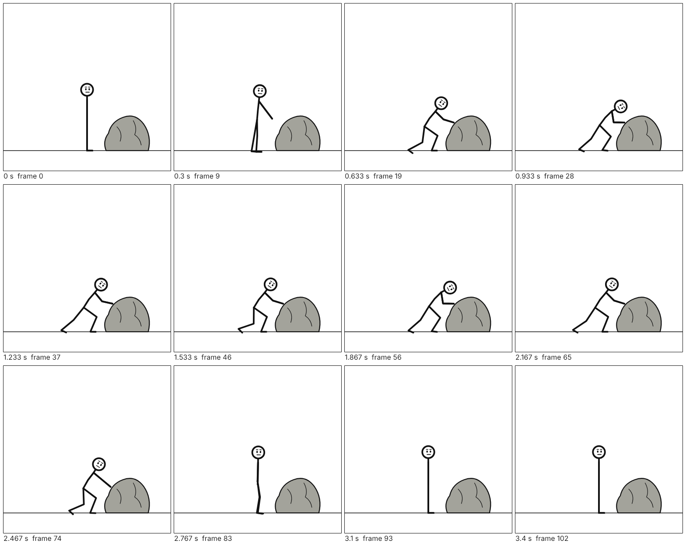
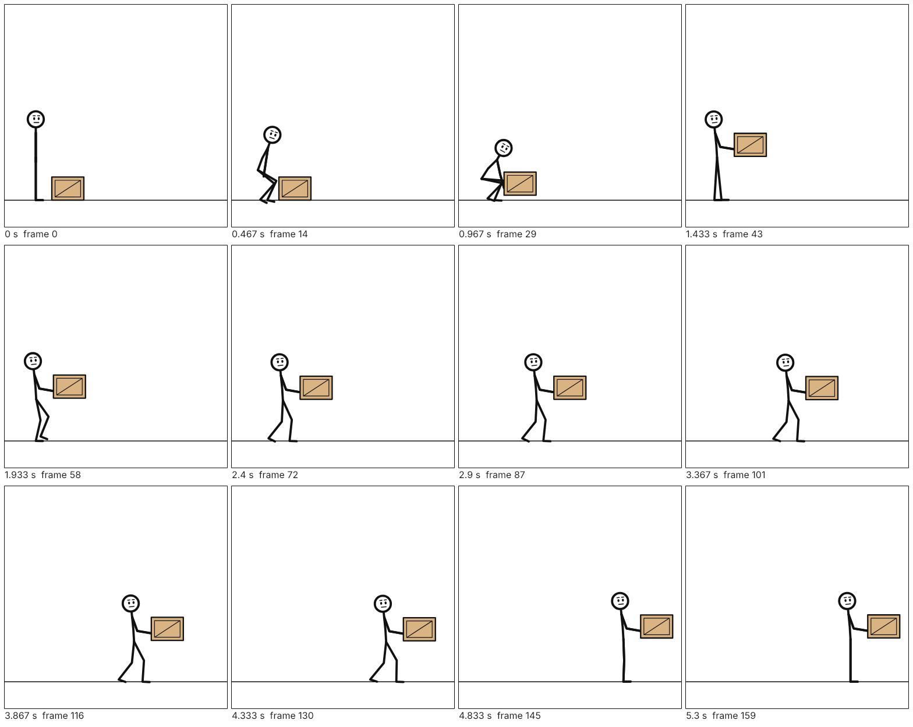
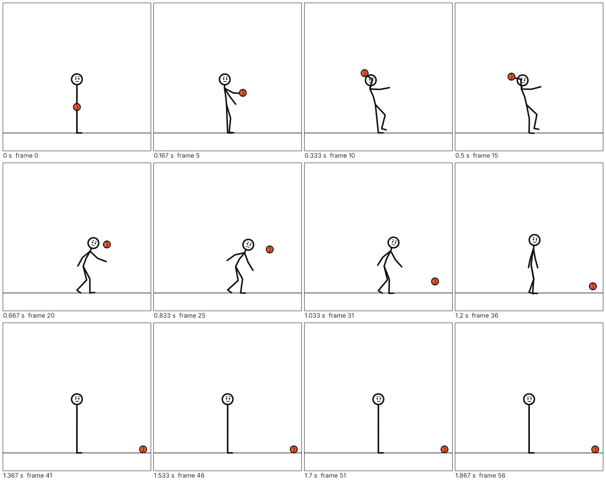
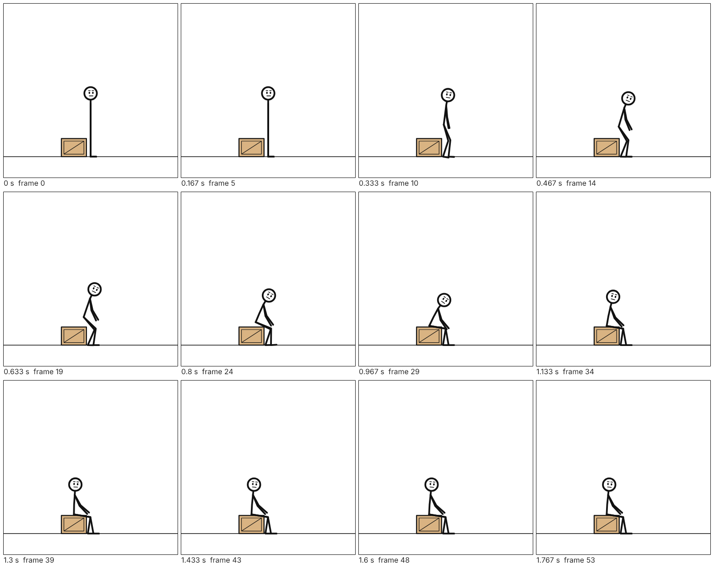
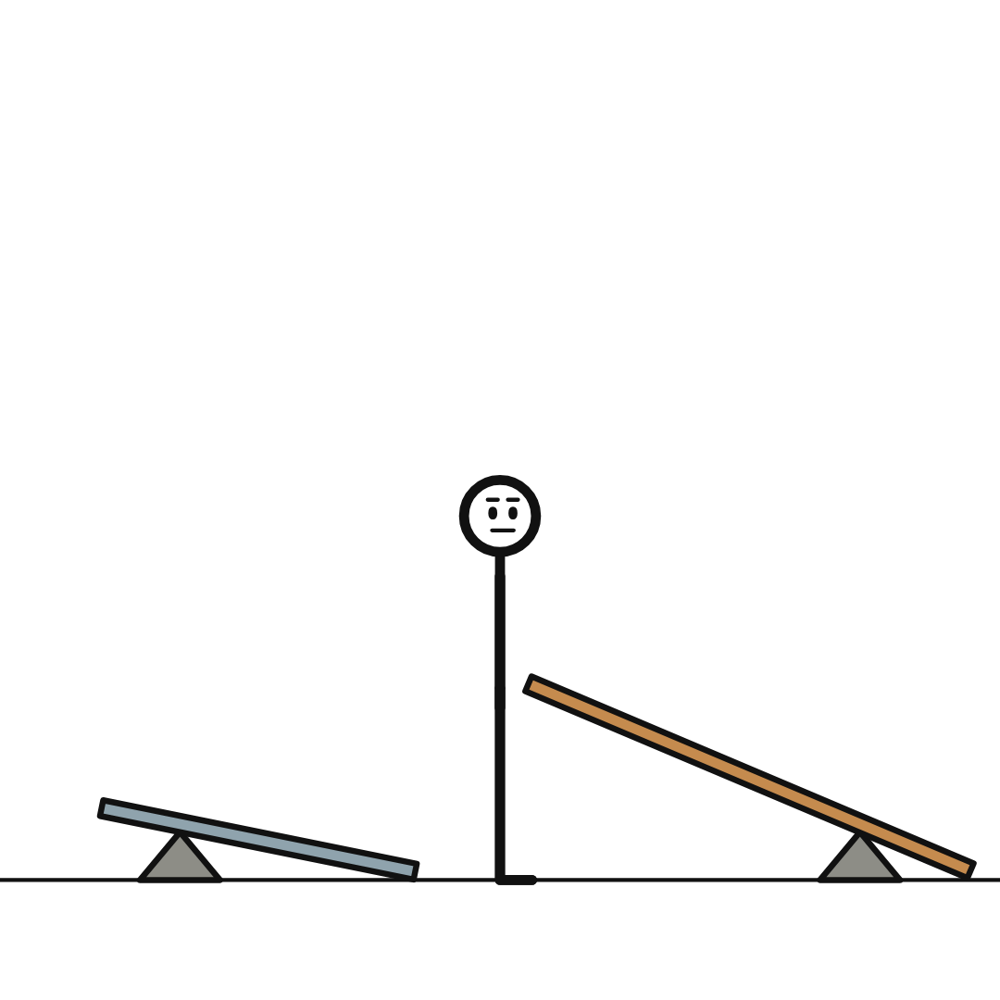
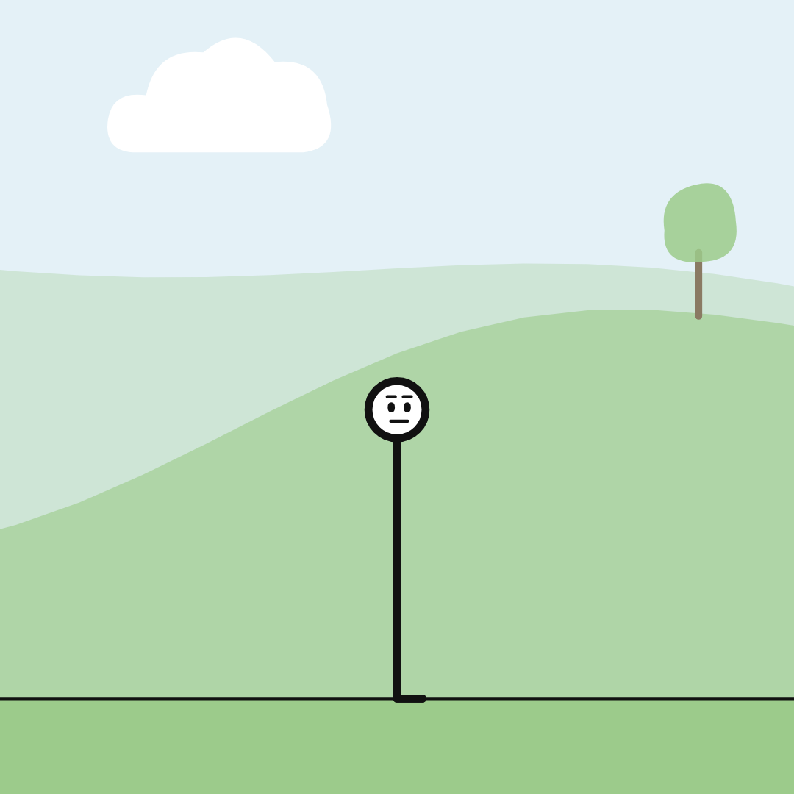

# charade

[](https://github.com/tomada1114/charade/actions/workflows/ci.yml)

Short 2D animations where stick figures act out an idea — written as code by AI agents.

<video src="https://github.com/tomada1114/charade/raw/main/docs/media/rock.mp4" width="540" controls muted loop playsinline></video>

[Watch the video (`docs/media/rock.mp4`)](https://github.com/tomada1114/charade/raw/main/docs/media/rock.mp4):
three ways to move a rock. Bare hands get nowhere, a lever shifts it a little, a cart
takes it away.

This is the whole scene, [`docs/media/rock.ts`](docs/media/rock.ts), written with the
built-in vocabulary alone:

```ts
import { scene } from "charade";

export default scene({ rows: 3 }, (stage) => {
  // Bare hands: heaves at the rock, gets nowhere and gives up.
  const bare = stage.row(0);
  bare.backdrop("hill");
  const boulder = bare.prop("rock");
  boulder.place({ x: 0.6, y: 0 });
  const pusher = bare.actor({ name: "pusher" });
  pusher.wait(0.4);
  const pushed = pusher.do("push", { prop: boulder, tries: 3, mood: "focused" });
  bare.effect("sweat", {
    on: pusher,
    at: pushed.marks.contact,
    duration: pushed.end - pushed.marks.contact,
  });
  pusher.do("slump", { mood: "dejected" });
  pusher.express("dejected", { at: pushed.end });

  // A lever: bears down on it and the rock shifts a little.
  const lever = stage.row(1);
  lever.backdrop("hill");
  const rock = lever.prop("rock");
  rock.place({ x: 1.66, y: 0 });
  const presser = lever.actor({ name: "presser" });
  presser.wait(0.4);
  const pressed = presser.do("push", {
    prop: rock,
    by: "lever",
    distance: 0.15,
    where: { x: 1.66, y: 0 },
    grip: { x: -1.41, y: 0.49 },
    mood: "focused",
  });
  lever
    .prop("lever", {
      swing: -0.3,
      swingAt: pressed.marks.heave,
      swingFor: pressed.marks.stop - pressed.marks.heave,
    })
    .place({ x: 1.08, y: 0 });
  presser.express("happy", {
    at: pressed.marks.stop,
    duration: pressed.end - pressed.marks.stop,
  });

  // A cart: lifts the rock onto it and wheels it away.
  const cartRow = stage.row(2);
  cartRow.backdrop("hill");
  const load = cartRow.prop("rock");
  load.place({ x: 0.6, y: 0 });
  const mover = cartRow.actor({ name: "mover" });
  mover.wait(0.4);
  const grip = { x: -0.3, y: 0.12 };
  mover.do("pickUp", { prop: load, where: { x: 0.6, y: 0 }, grip });
  mover.do("carry", { prop: load, grip, distance: 0.9, duration: 1.6 });
  const distance = 3.5;
  const carried = mover.do("carry", {
    prop: load,
    by: "cart",
    grip,
    from: 0.9,
    distance,
    duration: 4.6,
    mood: "happy",
  });
  const cart = cartRow.prop("cart", {
    roll: distance,
    rollAt: carried.marks.off,
    rollFor: carried.marks.stop - carried.marks.off,
  });
  cart.place({ x: 1.77, y: 0 });
  cart.move(
    { x: 1.77 + distance, y: 0 },
    { at: carried.marks.off, duration: carried.marks.stop - carried.marks.off },
  );

  stage.sync();
  pusher.wait(1);
});
```

`npx charade render rock.ts` turned it into that MP4 on the defaults: 1080×1080, 30 fps,
H.264 in yuv420p, 275 frames. The mover wheeling the cart out of the frame is meant, so
`check` only warns about it and `render` goes ahead:

```sh
npx charade check rock.ts
# warning ERR_CHECK_OFF_FRAME: row2/prop/cart/0 leaves the visible area of row 2, …
# warning ERR_CHECK_OFF_FRAME: row2/prop/rock/0 leaves the visible area of row 2, …
# warning ERR_CHECK_OFF_FRAME: row2/actor/mover/0 leaves the visible area of row 2, …
# => 0 errors, 3 warnings
```

`npx charade catalog` lists the installed vocabulary, and `--images` draws a sample of
each item. A few of them:

<table>
  <tr>
    <td></td>
    <td></td>
    <td></td>
  </tr>
  <tr>
    <td></td>
    <td></td>
    <td></td>
  </tr>
</table>

## Install

```sh
pnpm add charade
```

Requires Node.js 24 or newer. The package ships ESM only. CommonJS consumers need a
Node.js version with unflagged `require(esm)` support (20.19+, 22.12+, or 24+).

A scene needs no install at all: `npx charade render scene.ts` works in an empty folder,
and the scene's `import "charade"` resolves to the command itself. `render` calls the
`ffmpeg` on your `PATH`; the other commands do not need it.

## Agent Skills

An agent writes scenes through two skills kept in this repository's `skills/` directory:
[making a scene](skills/charade-scene/SKILL.md) and
[adding vocabulary](skills/charade-vocabulary/SKILL.md). Install them from the
repository, not from npm:

```sh
npx skills add tomada1114/charade
```

## Writing a scene

A scene file calls `scene` and exports the result. `build` runs once and records what
each actor does and when; nothing is drawn while it runs.

```ts
import { scene } from "charade";

export default scene({ rows: 2 }, (stage) => {
  const hero = stage.row(0).actor({ name: "hero" });
  const friend = stage.row(1).actor({ name: "friend" });

  // Calls without `at` play one after the other.
  hero.pose({ hipR: 1.4, kneeR: 1.5, spine: 0.3 }, { duration: 0.6 });
  const wave = hero.reach("handR", { x: 0.25, y: 0.95 }, { duration: 0.4 });
  hero.wait(0.5);

  // `at` is absolute scene time; every call returns its span in seconds.
  friend.pose({ neck: 0.3 }, { at: wave.start, anticipation: 0.1 });

  // Depth 3: motion as a function of time, on the joints it names only.
  friend.drive((t) => ({ spine: Math.sin(t * 3) * 0.1 }), {
    at: wave.end,
    duration: 1,
    mode: "add",
  });
});
```

- Time is in seconds, angles are radians, and points are in a row's own units: the
  origin on the ground at the row's centre, `y` up, a standing figure 1 unit tall.
- `pose` moves the channels it names and holds them; `reach` puts a hand or a foot on a
  point; `drive` runs channels as a function of time and `cycle` repeats keyed values,
  which stays data; `wait` moves the actor's cursor on. When two calls overlap, the one
  recorded later wins for the channels it names, blended in over `blend` seconds (0.2 by
  default).
- `stage.row(i)` names a row, 0 at the top; on a one-row scene the stage is the row.
  `stage.sync()` moves every actor's cursor to the latest end. `row.draw` records a free
  drawing on a `ShapeContext`.
- `row.label(text)` shows free-standing text, to the end of the scene unless it has a
  `duration`; `actor.say(text)` shows a speech bubble above the actor's head for a
  reading time and occupies the actor like a `wait`. Sizes and positions are in row
  units. Japanese and other non-Latin text is drawn in the first installed font of a
  per-system list (macOS: Hiragino Sans; Windows: Yu Gothic; Linux: Noto Sans CJK), or
  in the font file the scene names with its `font` option, relative to the scene file.
  No font is bundled; without one, the text is drawn in a fallback font and `check` says
  so (`ERR_ENV_FONT_MISSING`). `check` also warns about text below 12 px at the output
  size (`ERR_CHECK_TEXT_TOO_SMALL`) and text that leaves its row
  (`ERR_CHECK_OFF_FRAME`).

```ts
import { scene } from "charade";

export default scene({ rows: 2 }, (stage) => {
  stage.row(0).label("Before", { at: 0 });
  stage.row(1).label("After", { x: -1, align: "left" });

  const hero = stage.row(0).actor();
  const hello = hero.say("こんにちは！");
  hero.say("Shall we go for a walk?", { at: hello.end, width: 1.5 });
});
```

- The result is frozen data: `kind: "charade.scene"`, the `timeline`, and the `findings`
  recorded while the scene ran. An unknown name or a bad value is a finding with a `fix`
  line, and the scene goes on with a placeholder, so one run reports every mistake.

## API

All public symbols are named exports from the package root. Deep imports are private and
blocked by the package export map.

- `CharadeError` is the base of every error charade throws. Branch on its stable `code`,
  never on `message`.

```ts
import { CharadeError } from "charade";

function reasonOf(error: unknown): string {
  return error instanceof CharadeError ? error.code : "unknown";
}

console.log(reasonOf(new Error("not ours")));
// => "unknown"
```

- `UnknownFlagError` (`ERR_CLI_UNKNOWN_FLAG`) is thrown for a flag a command does not
  have; its `path` names the flag, never the value passed with it.
- `AsyncBuildError` (`ERR_SCENE_ASYNC_BUILD`) is thrown when a scene's `build` returns a
  promise, `UnknownRowError` (`ERR_SCENE_UNKNOWN_ROW`) when `stage.row(i)` names a row
  the scene does not have (its `rows` is the row count), and `SceneClosedError`
  (`ERR_SCENE_CLOSED`) when a handle is used after `scene()` returned.
- `Finding`, `Severity` and `SourceLocation` describe one problem found in a scene as
  plain data: an `ERR_<AREA>_<FAILURE>` `code`, an `error` or `warning` severity, what
  is wrong, how to fix it, and where it applies.
- `FindingCollector` records findings up to `FINDING_CAP` (20), keeping the first ones,
  except that a warning gives way to an error: at the cap, a later error takes the place
  of the last warning kept, so a run with an error never passes.
- `exitCodeFor` maps findings to an `ExitCode` (0 clean, 1 failing findings, with
  `strict` making warnings fail; `COULD_NOT_RUN` is 2), and `checkReport` builds the
  `CheckReport` document `{ version, ok, findings, summary }`.

```ts
import { checkReport, exitCodeFor, type Finding } from "charade";

const findings: Finding[] = [
  {
    code: "ERR_CHECK_OFF_FRAME",
    severity: "warning",
    message: "hero leaves the frame",
    fix: "Ignore it if the exit is meant",
  },
];
console.log(exitCodeFor(findings), exitCodeFor(findings, { strict: true }));
// => 0 1
console.log(checkReport(findings).summary);
// => { errors: 0, warnings: 1, truncated: false }
```

- `DrawingContext` is the drawing context the engine draws a frame on: the standard
  Canvas 2D members whose arguments and results are numbers, strings or this package's
  own `Gradient` and `TextMeasurement`. `ShapeContext` is the same without `reset` and
  the text members, and is what a depth 4 drawing callback receives: a drawing shares
  the frame's context, so it cannot clear what was drawn before it. Both are
  receive-only: you are handed one, never implement it.

```ts
import type { ShapeContext } from "charade";

function drawBall(ctx: ShapeContext): void {
  const shade = ctx.createRadialGradient(0, 0.1, 0, 0, 0.1, 0.1);
  shade.addColorStop(0, "#ffd166");
  shade.addColorStop(1, "#e4572e");
  ctx.beginPath();
  ctx.arc(0, 0.1, 0.1, 0, Math.PI * 2);
  ctx.fillStyle = shade;
  ctx.fill();
}
```

- `svgPath(ctx, d, options)` adds the shape in an SVG path's `d` string to the current
  path with ordinary path calls, so a shape drawn in an SVG editor can be a prop. SVG's
  `y` points down and the row's points up, so the shape is flipped; `scale` is row units
  per SVG unit and `origin` is the SVG point placed on the prop's ground point. Path
  data that does not parse throws `InvalidPathDataError`
  (`ERR_SCENE_INVALID_PATH_DATA`), whose `offset` says where.

```ts
import { defineProp, svgPath } from "charade";

// A leaf 100 units tall in the editor, its stem at (50, 100).
const LEAF = "M50 100 C0 60 20 10 50 0 C80 10 100 60 50 100 Z";

export const leafProp = defineProp({
  name: "leaf",
  description: "A leaf standing on its stem.",
  params: {},
  draw(ctx) {
    ctx.beginPath();
    svgPath(ctx, LEAF, { scale: 0.004, origin: { x: 50, y: 100 } });
    ctx.fillStyle = "#6a994e";
    ctx.fill();
  },
});
```

- `drawText(ctx, text, options)` draws text in a depth 4 drawing. A `ShapeContext` has
  no text members, since its `y` points up and raw text would come out upside down;
  `drawText` draws it the right way up, in the current fill style and the scene's font,
  centred on `x`, `y`, and returns the block's `width` and `height` so a shape can be
  fitted around it. `size` is the font size and `width` the width lines wrap at, both in
  row units.

```ts
import { defineProp, drawText } from "charade";

export const signProp = defineProp({
  name: "sign",
  description: "A board on a post, with a word on it.",
  params: {
    word: { type: "text", default: "止まれ", doc: "What the sign says." },
  } as const,
  draw(ctx, { word }) {
    ctx.strokeRect(-0.35, 0.5, 0.7, 0.3);
    ctx.beginPath();
    ctx.moveTo(0, 0);
    ctx.lineTo(0, 0.5);
    ctx.stroke();
    drawText(ctx, word, { y: 0.65, size: 0.12 });
  },
});
```

- `defineAction`, `defineExpression`, `defineProp`, `defineBackdrop` and `defineEffect`
  make a vocabulary item from a name, a description, parameters written as plain data
  `as const`, and a `build` or `draw` method. Nothing is registered: pass the definition
  to `a.do`, `a.express`, `row.prop`, `row.backdrop` or `row.effect`, which also take a
  built-in by name (`builtinActions` and its siblings list them). A parameter without a
  `default` is required, and its type is derived from the specification. A malformed
  definition throws `InvalidDefinitionError`, `ReservedParameterError` (a parameter
  named `at`, `duration`, `mood`, `blend` or `mode`, or an effect's named `on`) or
  `InvalidDefaultError`; a bad value in a scene is a finding.

```ts
import { type ActionDefinition, defineAction, scene } from "charade";

const waveParams = {
  speed: { type: "number", default: 1, min: 0.5, max: 2, unit: "x", doc: "How fast." },
} as const;

const waveAction: ActionDefinition<typeof waveParams> = defineAction({
  name: "wave",
  description: "Raises the near hand and waves it.",
  params: waveParams,
  build(clip, { speed }) {
    clip.pose({ shoulderR: 2.6, elbowR: 0.4 }, { duration: 0.4 / speed });
    clip.pose({ elbowR: 1.2 }, { duration: 0.3 / speed });
    clip.pose({ elbowR: 0.4 }, { duration: 0.3 / speed });
  },
});

export default scene((stage) => {
  stage.actor().do(waveAction, { speed: 1.5 });
});
```

- The built-in actions are `stand`, `walk`, `run`, `cheer`, `point`, `think`, `sitDown`,
  `throw`, `slump`, `pickUp`, `push` and `carry`, with the expressions `neutral`,
  `happy`, `dejected`, `angry`, `surprised` and `focused`, and the props `ball`, `box`,
  `hoop`, `rock`, `lever`, `cart`, `ladder`, `desk`, `laptop` and `lightbulb`. A
  built-in is named by a string, and its parameters are typed by that name. `mood` puts
  an expression on the face for the length of an action, and an action lists the moods
  that also change its body. `throw` takes the prop it throws: the ball rides the near
  hand until the mark `release`, then flies a parabola. `pickUp`, `push` and `carry`
  take the prop they move the same way: `pickUp` leaves it in the hands, `push` slides
  it `distance` along the ground (0 strains and gets nowhere; `by: "lever"` bears down
  on a lever), and `carry` walks off with it in the arms or, `by: "cart"`, on a cart the
  scene moves over the times the returned marks give. `stand` breathes and blinks to the
  end of the scene without lengthening it, so it is the last call on an actor that has
  nothing more to do: an open-ended `stand` shows through wherever a later call has
  ended, so started first it would stand a seated figure back up. `walk` and `run` take
  the actor `distance` along the ground from `from` and leave it there. A prop has
  `place`, `hold` (it rides a hand or a foot) and `move` (a straight or arced path),
  which is how your own action moves one. A placed prop draws behind the actor;
  `place(point, { layer: "front" })` puts it in front, as for a desk the figure sits
  behind.
- The built-in backdrops are `plain`, `court`, `office`, `hill` and `night`:
  `row.backdrop("night")` draws behind that row only, and each paints its whole row at
  every canvas shape and row count. A drawing function's last argument is a
  `DrawMoment`: the scene time, `t` (seconds since the item began to show, which an
  open-ended item has too), the segment's progress, a seeded random source, and `view`,
  the row's visible area in the units the function draws in (`left`, `right`, `bottom`,
  `top`). A row is always 2.5 units high, but its width follows the canvas and the row
  count, so a backdrop of your own reads its edges from `view` instead of assuming them.

```ts
import { defineBackdrop, scene } from "charade";

const duskBackdrop = defineBackdrop({
  name: "dusk",
  description: "An orange sky over dark ground, across the whole row.",
  draw(ctx, _params, { view }) {
    const width = view.right - view.left;
    ctx.fillStyle = "#f6c79a";
    ctx.fillRect(view.left, 0, width, view.top);
    ctx.fillStyle = "#6b5a4e";
    ctx.fillRect(view.left, view.bottom, width, -view.bottom);
  },
});

export default scene({ rows: 2 }, (stage) => {
  stage.row(0).backdrop("office");
  stage.row(0).actor().do("sitDown");
  stage.row(1).backdrop(duskBackdrop);
  stage.row(1).actor().do("slump");
});
```

- The built-in effects are `sweat`, `impact`, `speedLines` and `sparkle`: accents drawn
  in front of the actor. `row.effect(name, { on })` says where, and `on` is the one
  option it takes beside `at`, `duration` and the effect's own parameters: an actor (the
  centre of its head), `{ actor, part, offset }` for its `head`, `pelvis`, `handL`,
  `handR`, `footL` or `footR`, or a point `{ x, y }` of the row. An effect on an actor
  follows that part every frame; without `on` it sits on the row's origin. Its scatter
  comes from the scene's `seed`.

```ts
import { scene } from "charade";

export default scene((stage) => {
  const hero = stage.actor();
  const ball = stage.prop("ball");
  const thrown = hero.do("throw", { ball, bounce: false });
  // The default throw lands at (1, 0), sqrt(8 × 0.3 / 12) s after the release.
  stage.effect("impact", {
    on: { x: 1, y: 0.06 },
    at: thrown.marks.release + Math.sqrt(0.2),
    duration: 0.4,
  });
  const slump = hero.do("slump", { mood: "dejected" });
  stage.effect("sweat", { on: hero, at: slump.start, duration: slump.duration });
});
```

```ts
import { scene } from "charade";

export default scene({ rows: 2 }, (stage) => {
  const top = stage.row(0);
  top.prop("box").place({ x: -0.24, y: 0 });
  const sitter = top.actor();
  sitter.do("sitDown", { mood: "dejected" });
  sitter.do("slump");

  const bottom = stage.row(1);
  const ball = bottom.prop("ball");
  const thrower = bottom.actor();
  const thrown = thrower.do("throw", { ball, to: { x: 2, y: 0 }, mood: "focused" });
  thrower.express("neutral", { at: thrown.marks.release });
});
```

See the generated TypeDoc documentation from `pnpm docs:build` for the full API
reference.

## Development

```sh
corepack pnpm@11.18.0 install --frozen-lockfile
pnpm hooks:install
pnpm check
```

See [CONTRIBUTING.md](CONTRIBUTING.md) for the complete workflow.

## License

Code: [MIT](LICENSE) © tomada. Assets — the character, the props, the backdrops and the
media under `docs/media/` — are self-made and dedicated to the public domain under
[CC0 1.0](https://creativecommons.org/publicdomain/zero/1.0/).
